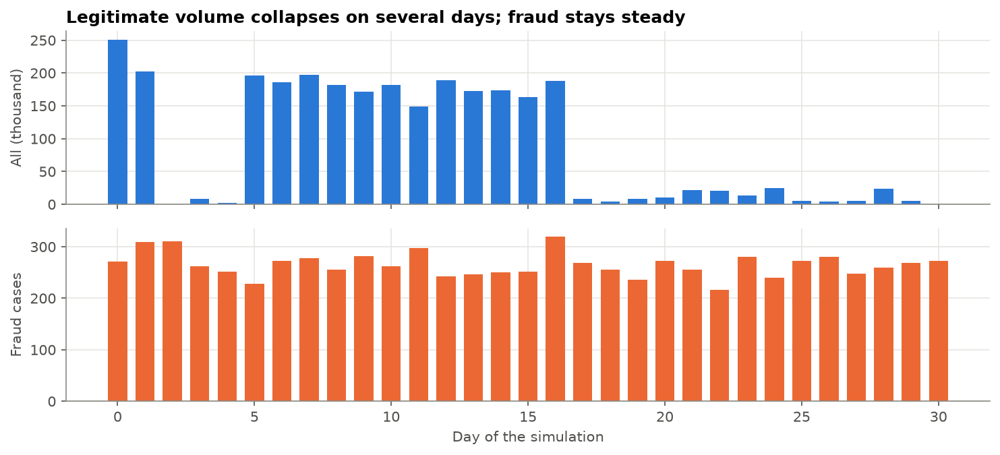
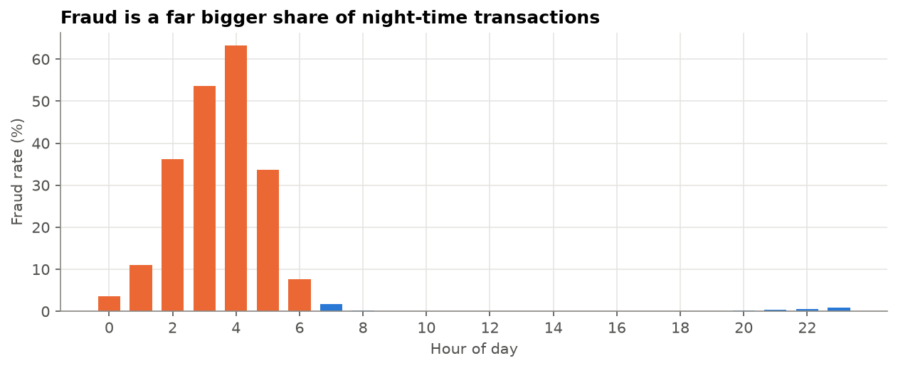
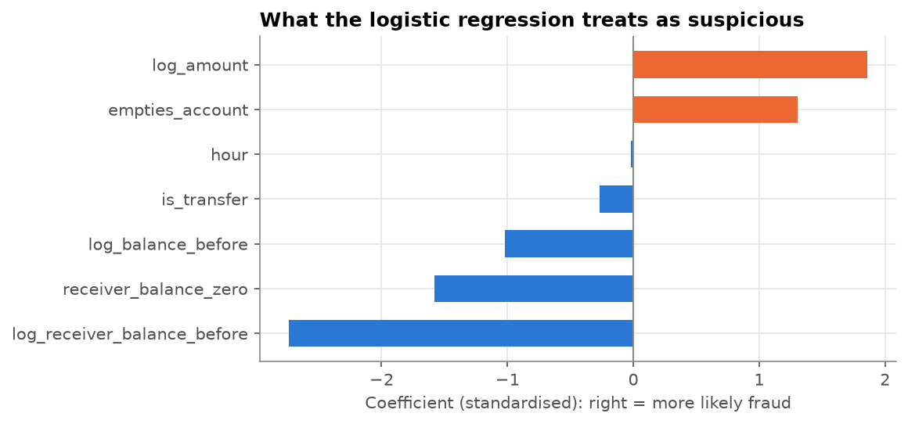
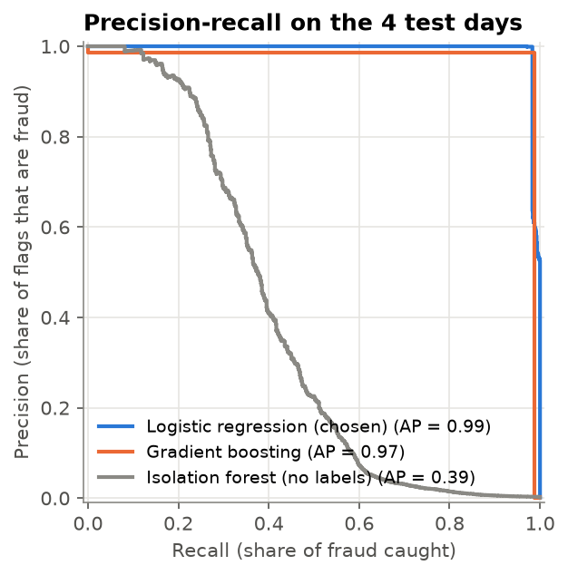
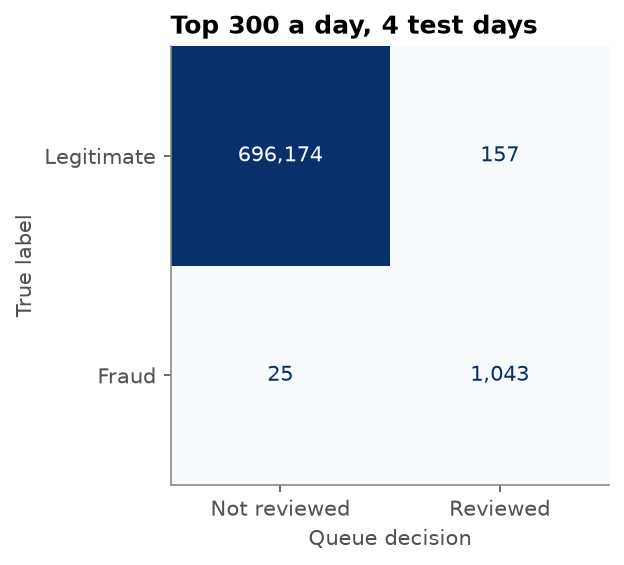

# Fraud Detection: A Daily Review Queue for Mobile Money

## 1. Business problem

**Client and context.** The imagined client is a South African mobile money provider (a bank-backed wallet that lets customers send money to each other and cash out at agents and ATMs). Its fraud team reviews suspicious transactions by hand: an analyst looks at the transaction, may call the customer, and can hold or reverse it.

**Question.** Which transactions should the fraud team review each day, so that it catches most fraud without burying the team in false alarms it learns to ignore?

**Cost of mistakes.**

| Mistake | What happens | Assumed cost |
|---|---|---|
| False negative (missed fraud) | The money leaves the customer's account and is cashed out. The provider usually reimburses the customer and loses trust. | The full transaction amount, typically thousands of rand or more, plus the investigation |
| False positive (false alarm) | An analyst spends about 15 minutes on a legitimate transaction; the customer may get a call or a short hold | About R60 of analyst time, plus some customer annoyance |

A missed fraud costs hundreds or thousands of times more than a false alarm. But false alarms have a hidden cost too: if most flags turn out to be nothing, analysts start skimming them, and real fraud slips through a queue nobody trusts.

**Capacity.** I assume a team of **6 analysts, each reviewing about 50 cases a day: 300 reviews a day**. That number, not a probability of 0.5, sets how many transactions the model may flag.

**Metric and reasoning.** Accuracy is useless: fraud is so rare that "nothing is fraud" is over 99% accurate. The measures that matter are:

- **Recall within capacity:** of all fraud, what share lands in the daily top 300?
- **Precision of the queue:** what share of the 300 reviews are real fraud? This decides whether the team trusts the queue.
- **Value caught:** how much money the queue protects, because one large theft matters more than several small ones.

I compare models with the **precision-recall curve and PR AUC**, not ROC AUC alone, because ROC AUC looks flattering on rare events.

## 2. Data

**Source:** [PaySim](https://www.kaggle.com/datasets/ealaxi/paysim1) (CC BY-SA 4.0), a simulated mobile money transaction log built from one month of real transactions at a mobile money service in an African country (Lopez-Rojas, Elmir and Axelsson, 2016, *PaySim: A financial mobile money simulator for fraud detection*). The notebook downloads an identical copy from a [Hugging Face mirror](https://huggingface.co/datasets/purulalwani/Synthetic-Financial-Datasets-For-Fraud-Detection) because it needs no login. 6,362,620 transactions over 743 hours (31 days).

Real transaction-level fraud data is almost never public, in South Africa or anywhere else, because of privacy law (POPIA here) and bank secrecy. A simulation calibrated on real data is the standard way to show the method.

| Column | Meaning |
|---|---|
| `step` | Hour of the simulation, 1 to 743. Hour of day and day number are derived from it. |
| `type` | `CASH_IN`, `CASH_OUT`, `DEBIT`, `PAYMENT` or `TRANSFER` |
| `amount` | Transaction amount in the simulator's currency (read as rand for this framing) |
| `nameOrig` | Account sending the money. Always a customer (`C...`). |
| `oldbalanceOrg`, `newbalanceOrig` | Sender's balance **before** and **after** the transaction |
| `nameDest` | Receiving account: customer (`C...`) or merchant (`M...`, payments only) |
| `oldbalanceDest`, `newbalanceDest` | Receiver's balance before and after. Not recorded for merchants (always 0). |
| `isFraud` | Label: transaction made by one of the simulator's fraudster agents, who take over an account and try to empty it |
| `isFlaggedFraud` | The provider's existing rule, aimed at very large transfers. It fired 16 times in the whole month. |

**Before and after.** A fraud check happens *before* a transaction is approved, so the "after" balances would not be available to a real model. Step 3 checks whether they leak the answer.

## 3. What the data shows

1. **Fraud is extremely rare.** 8,213 frauds in 6.4 million transactions, 0.13%. Predicting "no fraud" for everything would be 99.87% accurate.
2. **Fraud happens only in transfers and cash-outs.** Payments, cash-ins and debits contain no fraud at all, so the model only scores transfers and cash-outs (2.77 million, 44% of volume).
3. **The simulation has quiet days.** Fraud stays at about 250 to 300 a day, but legitimate volume collapses on days 2 to 4 and from day 17. On those days fraud looks like half of all traffic, which no real provider would see. **I keep only the 14 normal-volume days** (2.6 million transactions, about 270 frauds a day, 0.15%).
4. **Fraud has a signature.** In 98% of fraud cases the amount is the account's **entire balance**, which legitimate transactions in this data almost never do. Fraud amounts are larger (median 412,500 against 171,400) and capped at 10 million per transaction, and fraud makes up a much bigger share of transactions at night, when honest customers are asleep.

5. **The "after" balances leak.** In 49% of frauds, money arrives at an account whose balance is zero both before and after receiving it, against 0.07% of legitimate transactions. That is impossible in a real ledger; it is a recording quirk of the simulator. The "after" balances are dropped, and the model uses only what is known when a transaction is made: type, amount, hour, and the balances before it.

## 4. Baselines

The 14 normal days are split **in time order**, never at random, because the model will always be used on future transactions:

| Part | Days | Transactions | Fraud |
|---|---|---|---|
| Train | first 8 | 1,568,556 | 2,157 |
| Validation (choose the model) | next 2 | 337,997 | 540 |
| Test (report to the business, used once) | last 4 | 697,399 | 1,068 |

| Baseline on the test days | Accuracy | Recall | Fraud let through |
|---|---|---|---|
| Predict "not fraud" for everything | **99.85%** | **0%** | 1,636 million |
| The provider's existing rule (`isFlaggedFraud`) | 99.85% | 0.1% (1 flag in 4 days) | almost all of it |

This is the **accuracy trap**: the "do nothing" model is 99.85% accurate and catches nothing.

## 5. Models

Three approaches, trained on the first 8 days and compared on the 2 validation days:

| Model | Idea | PR AUC | ROC AUC |
|---|---|---|---|
| **Logistic regression, `class_weight="balanced"`** | Each fraud counts about 700 times more during training | **0.987** | **1.000** |
| Isolation forest | Unsupervised: never sees the labels, flags what is unusual | 0.362 | 0.942 |
| Gradient boosting (`HistGradientBoostingClassifier`) | Learns interactions between features | 0.984 | 0.998 |

- **ROC AUC flatters everyone.** Even the weak isolation forest scores 0.94, because ranking hundreds of thousands of easy legitimate transactions below fraud is easy. PR AUC looks only at the flagged end of the list, where the team works, and separates the models clearly.
- **Unusual is not fraudulent.** The isolation forest finds some fraud without any labels, which is useful for a provider that has none, but it also flags honest unusual transactions such as large legitimate payments.
- **Simpler won.** The weighted logistic regression edges out gradient boosting. The fraud signature here is a few strong signals (whole balance taken, large amount, receiver with no money), which a linear model captures well. It is also the easiest to explain to a fraud manager and an auditor, so it goes forward.

## 6. Evaluation

The chosen model is refitted on train plus validation and scored once on the 4 test days: **PR AUC 0.993**.

**Threshold = capacity.** Each day, the 300 highest-scoring transfers and cash-outs go to the team:

| Test day | Fraud | Caught in top 300 | Recall | Precision | False alarms |
|---|---|---|---|---|---|
| 13 | 246 | 246 | 100% | 82% | 54 |
| 14 | 250 | 247 | 99% | 82% | 53 |
| 15 | 252 | 250 | 99% | 83% | 50 |
| 16 | 320 | 300 | 94% | 100% | 0 |
| **All 4 days** | **1,068** | **1,043** | **98%** | **87%** | **157** |

**The misses are informative:**
- **Day 16 is a staffing miss:** 320 frauds against 300 reviews. The queue was 100% fraud and 20 cases still got through. A better model cannot fix that; more reviewers or an automatic hold can.
- **Every other miss is a transfer of exactly 10 million that does not empty the account.** Large thefts are split into 10 million chunks (the per-transaction limit), and the early chunks leave money behind, so they lack the signature. Only 5 cases, but 50 million in value. A one-line rule, *review every transfer at the transaction limit*, closes the gap.
